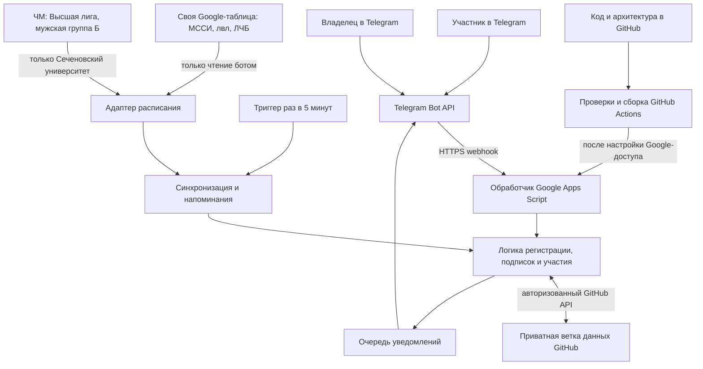

# Архитектура Telegram бота Сеченовского университета

Версия 1.0 от 17 октября 2026 года. Бот: [@sechenov_volley_bot](https://t.me/sechenov_volley_bot).

Спецификация описывает будущую реализацию для группы примерно из 20 человек. Бот собирает ФИО и подписки, показывает расписание, спрашивает об участии в играх и тренировках, напоминает о событиях и даёт владельцу поимённую статистику. Реализация и развёртывание этим документом не подтверждаются.

## 1. Принятые решения

- Основной репозиторий — приватный [um1ra/sechenov-volley-bot](https://github.com/um1ra/sechenov-volley-bot).
- Код, документация, несекретная конфигурация и постоянные данные бота хранятся в этом GitHub-репозитории. Локальные копии проекта и данных на компьютере владельца не создаются.
- Google Apps Script выполняет обработку Telegram-запросов и периодические задачи. Постоянный собственный сервер для первой версии не требуется.
- Google-таблицы остаются редактируемыми источниками расписания. Бот читает их и сохраняет нормализованные снимки и историю изменений в GitHub. Отдельной служебной Google-таблицы с ФИО и ответами не будет.
- Интерфейс пользователя и владельца — личная переписка с ботом. Отдельный сайт статистики не требуется.
- Все даты и время рассчитываются по Europe/Moscow. Пользовательский формат даты — ДД.ММ.ГГ.
- Тренировки проходят каждый понедельник и четверг в 19:30. Место — **Буревестник**. Адрес и координаты не подставляются.
- Токены и ключи не входят в файлы и историю Git. Для автоматизации используются GitHub Secrets; необходимые рабочие секреты обработчика находятся в закрытых Script Properties Apps Script. Это исключение для учётных данных: исполняемый код и необходимые секреты неизбежно должны быть доступны среде Google. ФИО, ответы и подписки в Script Properties не сохраняются.

## 2. Общая схема



GitHub хранит состояние и историю, Google выполняет код, Telegram доставляет сообщения. GitHub Actions используется для проверки и сборки кода, а не как постоянно работающий процесс Telegram-бота.

## 3. Регистрация и меню

Пользователь нажимает /start, вводит ФИО и выбирает несколько подписок: МССИ, ЛВЛ, ЧМ, ЛЧБ. Тренировки — отдельная подписка. ФИО можно исправить, подписки можно включать и отключать.

Человек определяется по числовому Telegram user ID, а не по ФИО или username. Совпадающие ФИО не объединяются. Повторный /start открывает существующий профиль.

Для закрытой группы предлагается подтверждение нового участника владельцем. До подтверждения пользователь видит состояние своей заявки, но не получает расписание группы и рассылки. Это проектное правило доступа первой версии.

Пользовательское меню:

- «Игры на этой неделе».
- «Игры в этом месяце».
- «Тренировки».
- «Мои ответы».
- «Мои подписки».
- «Изменить ФИО».
- «Остановить уведомления».

«На этой неделе» означает оставшиеся события текущей календарной недели с понедельника по воскресенье. «В этом месяце» — оставшиеся события текущего календарного месяца. События показываются по выбранным подпискам в хронологическом порядке.

Карточка содержит лигу или пометку «Тренировка», соперника для игры, день недели, дату ДД.ММ.ГГ, время МСК, место и «сегодня», «завтра» или «через N дней». N считается по календарным датам Москвы при каждом показе карточки. Обратный отсчёт не хранится как постоянное число.

## 4. Источники расписания

| Направление | Источник и выбор событий | Команда |
| --- | --- | --- |
| МССИ | Своя таблица, лист «МССИ» | Сеченовский университет |
| ЛВЛ | Своя таблица, лист «лвл» | Сеченовский университет |
| ЛЧБ | Своя таблица, лист «ЛЧБ» | Росэнергоатом |
| ЧМ | Чужая таблица, лист «Высшая лига (муж, гр Б)», gid 2047287896 | Сеченовский университет в хозяевах или гостях |
| Тренировки | Правило повторения и исключения в GitHub | Буревестник, пн и чт, 19:30 |

[Своя таблица](https://docs.google.com/spreadsheets/d/1qoniSvNsRrRpxPycM8vqMcZq7gvO7lcGLYdjrEz0L3k/edit).

[Таблица ЧМ с нужным листом](https://docs.google.com/spreadsheets/d/1WKhrg8yCAgbkB1bBg7XPv78H1z772IesmB8aKJYBh_Q/edit?gid=2047287896#gid=2047287896).

У своей таблицы шесть полей: ID игры, дата, время МСК, соперник, место или адрес, статус. Существующие ID MSSI-001, LVL-001, LCHB-001 и остальные сохраняются при переносе. Номер строки не является ID. Статусы источника: «В расписании», «Перенос», «Отменена», «Сыграна».

Начальный набор содержит 9 игр МССИ, 8 ЛВЛ и 10 ЛЧБ. Для МССИ и ЛВЛ исходным является текстовый список владельца с датами 2026 года. В частности, CITY — 05.11.2026, SV BJORN — 05.12.2026. Противоречащие им даты из снимка сайта автоматически не подставляются.

Для ЧМ постоянный ключ включает сезон, лигу и номер игры из источника. Название команды сравнивается с нормализацией регистра, пробелов и букв е/ё; широкое совпадение по слову «университет» не используется. Учитываются явно указанные переносы даты. Год выводится из сезона и полной даты источника, чтобы январские игры сезона 2026/27 относились к 2027 году.

Две игры ЛЧБ в один день — два отдельных события с собственными ответами и напоминаниями. Игры разных лиг не объединяются по дате или сопернику.

Тренировки создаются на восемь недель вперёд с ключом правила и первоначальной даты занятия. Отмена или перенос отдельной тренировки сохраняется в GitHub и не отменяет следующие занятия. Перенос сохраняет ID исходного занятия.

## 5. Компоненты и границы

Предлагаемый исходный язык — TypeScript. GitHub Actions собирает совместимый с Apps Script JavaScript. Предметная логика не зависит от SpreadsheetApp, UrlFetchApp, ScriptApp и файловой системы.

| Компонент | Ответственность |
| --- | --- |
| RegistrationService | ФИО, профиль, заявка и статус доступа |
| SubscriptionService | Подписки на лиги и тренировки |
| ScheduleService | Нормализация источников, стабильные ID, сравнение версий |
| TrainingService | Повторяющиеся занятия и исключения |
| AttendanceService | Ответы «Буду» и «Не буду», изменение ответа, ручная отметка владельца |
| ReminderService | Недельный опрос, повторный запрос и напоминание за сутки |
| AdminService | Поимённые списки, поиск событий, заявки, состояние системы |
| DeliveryService | Отправка и повторные попытки через очередь |
| GitHubStateRepository | Чтение и атомарное сохранение состояния |
| TelegramAdapter | Запросы Bot API и преобразование Telegram update в команды |
| SheetsAdapter | Чтение двух исходных книг и проверка схемы |
| AppsScriptRuntime | Webhook, триггер, секреты и ограничение параллельных операций |
| Clock | Текущее время для расчётов и проверок |

Основные контракты: StateRepository.read / transact, ScheduleSource.read, TelegramTransport.send / edit / acknowledge, Clock.now. Смена среды исполнения заменяет адаптеры, сохраняя правила подписок, участия и расписания.

## 6. Данные в приватном GitHub

Ветка main хранит документацию, исходный код, схемы и несекретную конфигурацию. Будущая отдельная ветка codex/bot-data хранит рабочие JSON-данные. Ветка данных не запускает сборку и публикацию кода.

Предлагаемая структура ветки данных:

```text
state/
  manifest.json
  users.json
  subscriptions.json
  events.json
  participation.json
  notifications.json
  processed-updates.json
  source-state.json
  operations.json
archive/
  YYYY/
    MM/
```

| Сущность | Основные поля |
| --- | --- |
| User | telegramUserId, privateChatId, fullName, accessStatus, registeredAt, deliveryStatus |
| Subscription | telegramUserId, scope: MSSI/LVL/CHM/LCHB/TRAINING, enabled, updatedAt |
| Event | eventId, sourceKey, kind, league, team, opponent, localDate, startAtUtc или null, venue, status, revision, attendanceRevision |
| Participation | eventId, telegramUserId, attendanceRevision, answer: yes/no/null, invitedAt, firstPollSentAt, answeredAt, answerSource |
| Notification | notificationId, eventId, telegramUserId, type, revision, dueAt, status, attempts, nextAttemptAt, messageId, sentAt |
| ProcessedUpdate | updateId, processedAt, operationId |
| SourceState | sourceId, lastSuccessAt, snapshotHash, errorStatus, missingEventChecks |
| Operation | operationId, actorId, action, targetId, at, result |
| Manifest | schemaVersion, stateVersion, runtimeEpoch, activeRuntime, archiveReferences |

Telegram ID и chat ID сериализуются как строки. Время хранения — UTC с отдельной локальной датой и часовым поясом события. История ответов сохраняет различие между ответом участника и действием владельца.

Завершённые данные архивируются помесячно в той же ветке GitHub. Активные файлы удерживаются небольшими; записи не теряются при архивировании. ФИО и ответы не включаются в сообщения коммитов и логи CI.

### Сохранение без потери параллельных ответов

Операция читает текущий commit SHA ветки данных, применяет команду и создаёт новое Git-дерево и коммит с этим родителем. Связанные изменения — ответ, обработанный update и очередь подтверждений — входят в один коммит. Ветка обновляется только с force=false.

Если другая операция успела сохранить ответ первой, приложение перечитывает состояние и повторно применяет команду. Не более трёх попыток за один запрос; повторяемость обеспечивается updateId и operationId. Принудительная перезапись ветки запрещена. Поведение fast-forward описано в [GitHub Git References API](https://docs.github.com/en/rest/git/refs#update-a-reference).

Пользователь получает окончательное подтверждение «Ответ сохранён» только после успешного обновления ветки. При недоступности GitHub бот не утверждает, что сохранил изменение. Script Properties и CacheService не используются как запасная база данных.

## 7. Опросы и напоминания

| Момент | Получатели и действие |
| --- | --- |
| За 7 суток | Участникам с активной подпиской отправляется карточка и кнопки «Буду» / «Не буду» |
| Через 24 часа после доставки первого опроса | Одно дополнительное сообщение тем, у кого всё ещё нет ответа, если событие ещё не началось |
| За 24 часа | Напоминание всем активным подписчикам направления, включая ответивших «Буду» и «Не буду» |
| После значимого изменения | Уведомление подписчикам затронутой лиги или тренировок |
| После отмены | Сообщение об отмене; оставшиеся опросы и напоминания отменяются |

Одинаковые правила применяются к играм и тренировкам. Используются персональные сообщения с кнопками, привязанными к событию и Telegram ID. Ответ можно изменить до начала события. После начала владелец сохраняет возможность внести исправление с записью в журнале.

Если игра появилась или человек подписался менее чем за неделю до неё, первый опрос отправляется при ближайшей обработке, без попыток отправить прошлые сообщения. Если событие ближе чем за сутки, опрос и ближайшее напоминание объединяются в одну карточку. Повторный запрос не отправляется после начала события. Совпавшие напоминания объединяются.

Для новых подписчиков учитываются только будущие события. Отключение подписки прекращает будущие рассылки этого направления; существующие ответы сохраняются в истории.

### Когда время игры ещё не заполнено

Без времени начала нельзя вычислить точный момент «за 24 часа». Проектное правило первой версии: опрос за семь календарных дней и напоминание за календарный день отправляются в 12:00 МСК с пометкой «Время игры пока не указано». Это правило предлагается для согласования и не считается точным напоминанием за сутки.

После появления времени используются интервалы 168 и 24 часа до начала. Бот уведомляет об уточнении времени; просроченные сообщения объединяются по правилам выше. Время матча не угадывается.

## 8. Синхронизация и переносы

Один периодический обработчик раз в пять минут читает источники, формирует события, сравнивает их с сохранённым состоянием, готовит задания и отправляет готовые уведомления небольшими порциями. Он сохраняет выполненную работу и продолжает следующую порцию при следующем запуске.

Проверяются дата, время, соперник, место и статус. Изменение оформления, перестановка строк, счёт и данные чужих команд не вызывают рассылку.

При изменении даты, времени, места или соперника сохраняются старое и новое значения, увеличивается attendanceRevision и запрашивается повторное подтверждение участия. Старые ответы остаются в истории; до нового подтверждения человек отображается в категории «Нужно подтвердить заново». Кнопки устаревшей версии события не меняют ответ и предлагают актуальную карточку.

При отмене никакого повторного опроса «Будете?» нет. Восстановление отменённого события создаёт новую версию участия.

Исчезновение строки проверяется по двум успешным чтениям подряд. Затем событие отмечается как «Снято из расписания», его будущие напоминания приостанавливаются, подписчики и владелец получают сообщение. Это не утверждение, что организатор официально отменил матч. Повторное появление того же ID восстанавливает событие.

Ошибка доступа, пустой подозрительный ответ, нарушение схемы или повторяющиеся ID не интерпретируются как массовая отмена. Сохраняется последний корректный снимок. Владелец получает сообщение об ошибке источника и отдельное сообщение о восстановлении. Если источник остаётся недоступен, карточки и напоминания показывают время последней успешной проверки.

Первое подключение источника создаёт исходный снимок без рассылки изменений за прошлое. Недельные опросы по будущим событиям в текущем окне формируются обычным способом.

## 9. Статистика владельца

Владелец открывает «Статистика», выбирает игру или тренировку и получает количество и список ФИО:

- ✅ Будут.
- ❌ Не будут.
- ⏳ Не ответили.
- 🔄 Нужно подтвердить заново — после переноса.

Статистика относится к конкретному событию. В списки попадают подтверждённые участники с соответствующей активной подпиской. Новые подписчики добавляются к будущему событию; отключившиеся исключаются из текущего ожидаемого состава, но их прежние ответы остаются в истории. Человек не считается отсутствующим из-за молчания.

Владелец может вручную поставить «Не будет» или «Будет», если участник сообщил лично. Журнал содержит автора, время, предыдущее значение и способ отметки. Последующий ответ самого участника обновляет текущий статус и также остаётся в истории.

Опрос фиксирует намерение прийти. Фактическая посещаемость и её проценты в первую версию не входят.

Другие пункты владельца: заявки на доступ, история ответов, отмена или перенос отдельной тренировки, ручная проверка расписания, состояние источников и доставки.

Административные права привязаны к Telegram ID. Первичная привязка владельца выполняется через одноразовый секрет настройки; первый случайный пользователь бота не становится администратором. Роль хранится в GitHub, а одноразовый код отключается после привязки. Все административные команды повторно проверяют права на сервере.

## 10. Telegram и секреты

Основной вход — HTTPS webhook Apps Script. Проверяются отдельный случайный секрет в URL-пути, JSON-схема, допустимый тип update, личный чат и права участника. BOT token в webhook URL не используется. Webhook URL с секретом не публикуется в репозитории или логах.

Telegram поддерживает secret_token в HTTP-заголовке, но документированный объект запроса Apps Script не предоставляет произвольные заголовки. Поэтому первая версия использует отдельный секрет пути и не заявляет проверку этого заголовка. Основание: [Telegram setWebhook](https://core.telegram.org/bots/api#setwebhook) и [Apps Script Web Apps](https://developers.google.com/apps-script/guides/web).

Для кнопок callback подтверждается оперативно; сообщение об успешном сохранении выдаётся после коммита. При повторной доставке update бизнес-действие не выполняется второй раз.

Совместимость реального webhook, HTTP-ответов Apps Script и повторной доставки ещё не подтверждена запуском — это не точное обещание работоспособности. До рабочего запуска обязательна проверка: успешный запрос получает 2xx после сохранения; сбой до сохранения не приводит к молчаливой потере команды; повтор не создаёт второй ответ или рассылку. Если среда не обеспечивает эти условия, входной адаптер подлежит пересмотру до подключения участников.

Рабочие секреты: TELEGRAM_BOT_TOKEN, BOT_GITHUB_TOKEN, WEBHOOK_SECRET и первоначальный OWNER_SETUP_SECRET. Доступ к GitHub ограничивается выбранным приватным репозиторием и необходимыми правами Contents. Учётные данные Google для публикации настраиваются отдельно.

GitHub Secrets не являются базой, из которой приложение может прочитать открытое значение токена: необходимые секреты безопасно передаются при настройке в Script Properties. Обычные данные бота туда не записываются. Редакторы Apps Script имеют доступ к рабочим секретам, поэтому проект доступен только владельцу.

Приватный репозиторий ограничивает чтение кода и данных. Имя бота и технический webhook не становятся скрытыми только из-за приватности репозитория; доступ к функциям регулирует само приложение.

Уже присланный в чат токен в GitHub не переносится. Перед запуском владелец перевыпускает его через BotFather. В этом документе и примерах реальные секреты отсутствуют.

## 11. Надёжность и ограничения

Каждое исходящее сообщение имеет стабильный ключ: участник, событие, версия и тип уведомления. Очередь содержит статусы pending, sending, sent, retry, uncertain и cancelled. Перед отправкой ещё раз проверяются подписка, версия события и актуальность задания.

Telegram-запросы выполняются после фиксации задания в GitHub. Успех Bot API сохраняет messageId и sentAt. Статус sent означает приём сообщения Telegram, а не прочтение пользователем.

При 429 учитывается retry_after. Явные временные ошибки обрабатываются ограниченными повторными попытками. Блокировка бота помечается отдельно и прекращает бессмысленные повторы для этого получателя.

Если отправка могла пройти, но ответ Telegram потерян, доставка считается uncertain. Автоматически утверждать «не отправлено» и повторять такое сообщение нельзя: владелец видит проблему и может повторить отправку. Абсолютная гарантия ровно одной доставки между GitHub и Telegram не заявляется.

Между запусками не держится постоянно работающий процесс. Состояние сохраняется до завершения запроса; принудительное прерывание не должно откатывать уже записанные ответы.

Пятиминутный шаг задаёт частоту проверки, но не гарантирует доставку ровно в секунду. Google допускает сдвиги запуска триггеров: [Installable Triggers](https://developers.google.com/apps-script/guides/triggers/installable). Задачи выбираются по dueAt и состоянию доставки, поэтому пропущенный запуск не теряет напоминание, если событие ещё впереди.

Для обычного аккаунта на момент проектирования Google указывает 90 минут работы триггеров и 20 000 URL Fetch-вызовов в сутки, а также 6 минут на одно выполнение. Чтение выполняется пакетами, неизменившийся снимок не создаёт коммит. До запуска на 20 участниках замеряются фактическое время и число API-запросов: [квоты Apps Script](https://developers.google.com/apps-script/guides/services/quotas).

GitHub API также имеет основные и дополнительные ограничения. Входящие ответы объединяются в транзакции, фоновые изменения записываются пакетами; при ограничении сервис сохраняет задания и продолжает после разрешённого срока: [GitHub REST API rate limits](https://docs.github.com/en/rest/using-the-rest-api/rate-limits-for-the-rest-api).

«Состояние системы» показывает последнюю проверку источников, размер очереди, ошибки, версию приложения и активную среду. Уведомления о сбое не повторяются каждые пять минут. При полном отказе самой среды её собственный код не сможет гарантированно сообщить о себе.

ФИО и ответы остаются в истории приватного Git. Удаление текущей записи не стирает её из прежних коммитов; очистка истории — отдельная операция владельца. Открытых страниц статистики и выгрузок с данными участников не создаётся.

## 12. Публикация и работа без локальных файлов

Исходная версия проекта редактируется прямо в GitHub через API или браузер. Документация и код не клонируются на компьютер владельца. Тесты и сборка выполняются в GitHub Actions на облачном runner.

Планируемая структура main:

```text
README.md
docs/superpowers/specs/2026-10-17-sechenov-volley-bot-design.md
src/core/
src/application/
src/ports/
src/adapters/apps-script/
src/adapters/github/
src/adapters/telegram/
src/adapters/google-sheets/
config/
tests/
.github/workflows/
```

Этот список описывает будущую структуру; создание одного документа не означает, что исходники и workflows уже реализованы.

Публикация Apps Script выполняется из проверенной сборки GitHub после настройки Google OAuth и Script ID. Первую авторизацию Google и внесение секретов выполняет владелец. Исполняемая копия кода размещается в Google: GitHub служит источником версии, но не заменяет среду исполнения.

Запуск публикации — отдельное явное действие; коммиты с данными участников не публикуют код. Ветка данных и файлы с ФИО не включаются в артефакты сборки. Проверки используют синтетических участников, не реальные токены или персональные данные.

Параллельные действия владельца — создание бота, заполнение времени игр и подготовка доступов — объясняются ему в чате. Отдельный список его поручений в репозитории не создаётся.

## 13. Переключение на другую среду

Сначала переносится обработчик, а постоянные данные остаются в том же приватном GitHub. Новый адаптер среды должен реализовать прежние контракты; Telegram-бот, подписки, eventId, ответы и история доставки сохраняются.

Порядок переключения:

1. Подготовить и проверить новую среду с отключённой отправкой сообщений.
2. Перевести текущую среду в режим остановки записи и отправки, дождаться завершения операций.
3. Сохранить контрольный commit SHA и проверить очереди отправок с неопределённым результатом.
4. Увеличить runtimeEpoch и назначить новый activeRuntime в GitHub. Каждая изменяющая операция проверяет epoch, что блокирует запись старой среды после переключения.
5. Обновить webhook Telegram на новую среду, сохраняя ожидающие updates.
6. Запустить ровно один планировщик и проверить ответ пользователя, смену подписки и контрольное уведомление.
7. При возврате повторить процедуру с новым epoch. Рабочую ветку данных не откатывать к старому коммиту вместе с кодом.

Проверка epoch перед отправкой уменьшает риск двух отправителей, но не отменяет уже начавшийся сетевой запрос; поэтому остановка и ожидание старой среды обязательны. Автоматическое аварийное переключение в первую версию не входит.

Вынос данных из GitHub в отдельную СУБД не является частью этой архитектуры и требует отдельного решения владельца.

## 14. Критерии приёмки

1. Повторная регистрация не создаёт дубликат, смена ФИО не создаёт нового участника.
2. Подписчик каждой лиги получает только соответствующие игры; тренировки включаются отдельно.
3. Из ЧМ выбираются только игры Сеченовского университета на мужском листе группы Б.
4. Две игры ЛЧБ в один день сохраняют независимые ответы и уведомления.
5. Недельный опрос, один повтор для неответившего и напоминание за сутки проверяются на управляемом времени.
6. «Не буду» сохраняется поимённо; молчание не превращается в отказ.
7. Ручная отметка владельца отличается в истории от ответа участника.
8. Перенос показывает прежние и новые значения, блокирует устаревшие кнопки и требует нового подтверждения.
9. Отмена прекращает напоминания; отказ источника не отменяет все игры.
10. Регулярные тренировки создаются на пн/чт, 19:30 МСК, место «Буревестник»; исключение не ломает серию.
11. Параллельные ответы разных людей не перезаписывают друг друга.
12. Повтор webhook и повтор фонового задания не повторяют уже подтверждённую бизнес-операцию.
13. Реальный webhook проходит проверку успешных ответов, отказов и повторной доставки.
14. Ошибки Telegram и GitHub, ограничения частоты и неопределённая доставка видны владельцу.
15. Расчёт дней, неделя, месяц, границы года и игры без времени проверены отдельно.
16. Посторонний пользователь не получает административные списки или функции.
17. Проверены реальная длительность задач, объём GitHub API и URL Fetch на выбранном аккаунте.
18. После переключения среды прежние ответы и история отправок сохраняются.
19. В репозитории, логах CI и сборках отсутствуют рабочие токены.
20. Разработка и сборка выполняются через GitHub без сохранения локальной копии проекта.

## 15. Статус спецификации

Этот документ фиксирует архитектуру и критерии будущей реализации. Обработчик, ветка данных, Google-проект, workflows, секреты и рассылки создаются на этапе реализации; их наличие не следует из публикации спецификации.

Проектные значения для проверки владельцем: подтверждение новых участников администратором, напоминание в 12:00 МСК для игр без времени и повторное подтверждение при смене места. Остальные требования взяты из согласованного описания бота.
